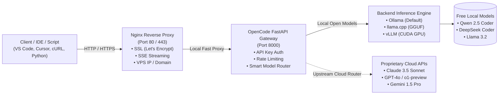

# OpenCode APIs

[](https://github.com/RomeoXLover/opencode-apis/actions/workflows/ci.yml)
[](https://opensource.org/licenses/MIT)
[](https://platform.openai.com/docs/api-reference)
[](#-inference-engines)

Turn any Linux VPS (CPU or GPU) into a private, high-performance, **OpenAI-compatible AI coding API**. Host free, open-weight coding models (Qwen 2.5 Coder, DeepSeek Coder, CodeLlama, StarCoder2, Llama 3.2) locally, or use the **Hybrid Upstream Router** to route to proprietary frontier models like **Claude 3.5 Sonnet** and **GPT-4o** through a single unified endpoint using your **VPS IP address** or a **custom domain** with automated SSL.

---

## 🏛️ System Architecture



---

## 📁 Repository Structure (Modular 5-Folder Architecture)

```text
opencode-apis/
├── gateway/                 # 1. FastAPI API gateway & OpenAI compatibility proxy
│   ├── main.py              # Core FastAPI app (models, streaming SSE, completions)
│   ├── config.py            # Environment settings and rate limiting
│   ├── requirements.txt     # Python dependencies (FastAPI, uvicorn, slowapi, httpx)
│   └── Dockerfile           # Gateway container definition
├── engines/                 # 2. Inference engine configs and runners
│   ├── setup-engine.sh      # Wizard to configure Ollama, llama.cpp, or vLLM
│   ├── ollama/              # Ollama docker & Modelfile templates
│   ├── llamacpp/            # High-efficiency GGUF runner for low-spec CPU VPS
│   └── vllm/                # PagedAttention GPU server for Nvidia cloud instances
├── nginx/                   # 3. Web server & reverse proxy
│   ├── opencode.conf        # VirtualHost config for raw IP and custom domains
│   └── ssl-setup.sh         # Automated Let's Encrypt SSL installer (Certbot)
├── scripts/                 # 4. Management and automation CLI tools
│   ├── install.sh           # 1-Click master VPS installation script
│   ├── pull-model.sh        # Interactive selector for free open coding models
│   ├── gen-api-key.sh       # Cryptographic API key generator
│   └── benchmark.sh         # Latency and token/second performance tester
├── examples/                # 5. Ready-to-use client integrations
│   ├── curl_test.sh         # Raw cURL request and streaming examples
│   ├── python_client.py     # Python script using official openai SDK
│   ├── nodejs_client.js     # Node.js example using native fetch
│   └── continue_vscode.json # Configuration for VS Code Continue extension
├── docker-compose.yml       # Complete stack deployment file
├── .env.example             # Template for API keys and server configuration
├── MODELS.md                # Full directory of supported models & hardware specs
├── VPS_SPECS.md             # In-depth VPS specs & hardware scaling guide (Solo to Mass Use)
└── README.md                # Comprehensive documentation
```

---

## 🖥️ Recommended VPS Hardware & Scaling Guide

Choose your VPS configuration based on your intended usage level:

| Level | Intended Usage | Concurrent Requests | Recommended Hardware | Models | Est. Monthly Cost |
| :--- | :--- | :--- | :--- | :--- | :--- |
| **Level 1** | **Solo Developer / Hobbyist** | 1 – 2 users | 2–4 vCPU, 8GB RAM, NVMe (No GPU needed) | `qwen2.5-coder:7b` / `1.5b` | **$5 – $12 / mo** (Hetzner, OVH, Contabo) |
| **Level 2** | **Small Team / Startup** | 3 – 10 users | 4–8 vCPU, 16–32GB RAM (or 8GB GPU) | `qwen2.5-coder:7b`, `deepseek-coder:6.7b` | **$20 – $45 / mo** (Hetzner Dedicated, RunPod) |
| **Level 3** | **Organization / Agency** | 10 – 50 users | 8–16 vCPU, 32–64GB RAM, 1x 24GB GPU (RTX 4090 / A10G) | `qwen2.5-coder:14b`, `deepseek-coder-v2:16b` | **$60 – $160 / mo** (Lambda Labs, RunPod, AWS g5) |
| **Level 4** | **Mass Use / Public API** | 50 – 500+ users | 32–64 vCPU, 128GB+ RAM, Multi-GPU (A100/H100/L40S) + vLLM | `qwen2.5-coder:32b`, `qwen2.5-coder:14b` | **$250 – $900+ / mo** (Lambda, CoreWeave, GCP) |

👉 *For full mathematical memory formulas, KV cache sizing, provider benchmarks, and swap optimization, read the full [**VPS_SPECS.md**](VPS_SPECS.md) guide.*

---

## ⚡ 1-Click Installation on any Linux VPS

Works on **Ubuntu 20.04/22.04/24.04, Debian 11/12, CentOS/Rocky/RHEL**.

```bash
# 1. Clone the repository to your VPS
git clone https://github.com/RomeoXLover/opencode-apis.git
cd opencode-apis

# 2. Run the automated installer (requires root/sudo)
sudo ./scripts/install.sh
```

The script will automatically:
1. Detect your public VPS IP address.
2. Install the backend engine (Ollama) and system packages.
3. Download the state-of-the-art coding model **`qwen2.5-coder:7b`**.
4. Configure and launch the **FastAPI Gateway** as a systemd service.
5. Set up **Nginx** to expose the endpoints on Port 80 for your VPS IP.

---

## 🌐 Connecting to your API

### 1. Using your VPS IP directly:
Once installed, your API is reachable instantly over HTTP:
- **Base URL**: `http://YOUR_VPS_IP/v1`
- **Chat Endpoint**: `http://YOUR_VPS_IP/v1/chat/completions`
- **Models Endpoint**: `http://YOUR_VPS_IP/v1/models`
- **Health Check**: `http://YOUR_VPS_IP/health`

### 2. Using a Custom Domain with Free HTTPS (SSL):
1. Point your domain's DNS `A Record` to your VPS IP (e.g. `api.yourdomain.com` -> `198.51.100.25`).
2. Run the automated SSL setup script:
   ```bash
   sudo ./nginx/ssl-setup.sh api.yourdomain.com your-email@example.com
   ```
3. Your API is now live with HTTPS:
   `https://api.yourdomain.com/v1/chat/completions`

---

## 🤖 Supported Free Open-Source Models

For full parameter counts, RAM/VRAM tables, context windows, and performance benchmarks, see [**MODELS.md**](MODELS.md).

| Model ID | RAM Required | Best Use Case | Pull Command |
| :--- | :--- | :--- | :--- |
| **`qwen2.5-coder:0.5b`** | ~500 MB | Real-time autocomplete, $3 VPS | `ollama pull qwen2.5-coder:0.5b` |
| **`qwen2.5-coder:1.5b`** | ~1.3 GB | Fast scripts, utility functions | `ollama pull qwen2.5-coder:1.5b` |
| **`qwen2.5-coder:7b`** *(Default)* | ~5.2 GB | Daily full-stack programming (Recommended) | `ollama pull qwen2.5-coder:7b` |
| **`deepseek-coder:6.7b`** | ~4.5 GB | DeepSeek reasoning & infilling | `ollama pull deepseek-coder:6.7b` |
| **`qwen2.5-coder:14b`** | ~9.5 GB | Enterprise architecture & complex refactoring | `ollama pull qwen2.5-coder:14b` |
| **`qwen2.5-coder:32b`** | ~20 GB | GPT-4o rivaling code benchmark scores | `ollama pull qwen2.5-coder:32b` |
| **`llama3.2:3b`** | ~2.2 GB | Quick code translation & docstrings | `ollama pull llama3.2:3b` |

To download any new model interactively:
```bash
./scripts/pull-model.sh
```

---

## 🔒 Security & API Keys

By default, the installer allows open access on your VPS IP so you can test immediately. To lock down the API and require client tokens:

1. Generate a secure random key:
   ```bash
   ./scripts/gen-api-key.sh
   ```
2. Enable key validation in your `.env` file:
   ```properties
   REQUIRE_API_KEY=true
   API_KEYS=sk-opencode-YOUR_GENERATED_KEY,sk-opencode-ANOTHER_KEY
   ```
3. Restart the gateway service:
   ```bash
   sudo systemctl restart opencode-gateway
   ```
Now clients must include `-H "Authorization: Bearer sk-opencode-..."` with their requests.

---

## 💻 Integration Examples

### cURL (Streaming)
```bash
curl -N http://YOUR_VPS_IP/v1/chat/completions \
  -H "Content-Type: application/json" \
  -d '{
    "model": "qwen2.5-coder:7b",
    "messages": [
      {"role": "user", "content": "Write a Python script that calculates prime numbers."}
    ],
    "stream": true
  }'
```

### Querying Claude 3.5 Sonnet via Hybrid Router
If you have configured `UPSTREAM_API_KEY` in `.env`, you can query Claude 3.5 Sonnet or GPT-4o through your VPS IP just like a local model:
```bash
curl -N http://YOUR_VPS_IP/v1/chat/completions \
  -H "Content-Type: application/json" \
  -d '{
    "model": "claude-3-5-sonnet",
    "messages": [
      {"role": "user", "content": "Write an optimized WebAssembly Rust module for matrix multiplication."}
    ],
    "stream": true
  }'
```

### Python (`openai` SDK)
```python
from openai import OpenAI

client = OpenAI(
    base_url="http://YOUR_VPS_IP/v1",  # Or https://api.yourdomain.com/v1
    api_key="sk-opencode-sample-key"    # Your key or any string if auth is disabled
)

response = client.chat.completions.create(
    model="qwen2.5-coder:7b",
    messages=[{"role": "user", "content": "Create a React modal component with Tailwind CSS."}],
    temperature=0.2
)
print(response.choices[0].message.content)
```

### VS Code (Continue Extension)
Install the **Continue** extension in VS Code and paste this into `~/.continue/config.json`:
```json
{
  "models": [
    {
      "title": "My VPS Coder (Qwen 2.5 7B)",
      "provider": "openai",
      "model": "qwen2.5-coder:7b",
      "apiBase": "http://YOUR_VPS_IP/v1",
      "apiKey": "your-key"
    }
  ]
}
```

---

## 🛡️ Firewall Configuration

Make sure your VPS provider (e.g. Hetzner, DigitalOcean, AWS, Linode) allows traffic on ports 80 and 443:

```bash
# Ubuntu UFW Firewall setup
sudo ufw allow 80/tcp    # HTTP (Nginx)
sudo ufw allow 443/tcp   # HTTPS (SSL)
sudo ufw allow 22/tcp    # SSH
sudo ufw enable
```

---

## 📜 License

Distributed under the **MIT License**. Free for personal and commercial usage.
